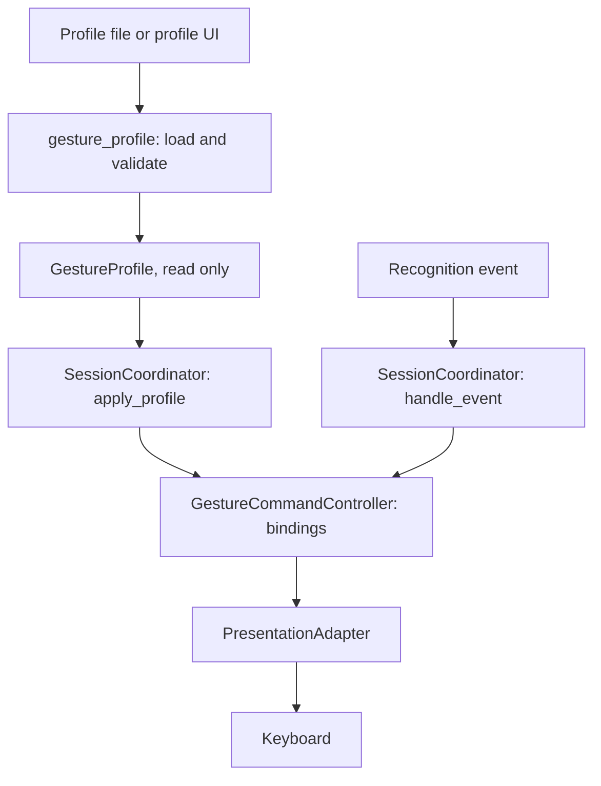

# Gesture Profile Architecture

**Jira:** SCRUM-168 and SCRUM-169
**Owner:** Joon Rho, R01
**Contracts:** `docs/sprint4/S4-R01-T1-Interface-Contracts.md`

This note describes how a gesture profile gets from a file to a keystroke and where it can be refused. It updates the Sprint 1 boundary in `architecture-decision-note.md`, which predates profiles.

## Layers

| Layer | Module | Job |
|---|---|---|
| Profile loading | `gesture_profile.py` | Reads a file or mapping and returns an immutable, valid profile or an error |
| Policy | `command_policy.py` | Says which commands exist and which a profile may bind |
| Session | `session_coordinator.py` | Passes gesture events on only while RUNNING and applies profiles only while not RUNNING |
| Controller | `gesture_command_controller.py` | Holds the active bindings and maps a gesture to an adapter call |
| Adapter | `presentation_adapter.py` | Turns an approved command into a key press |

## Two flows

**Changing a profile.** The profile is read and validated first. Nothing is activated if any part is wrong. The session must not be RUNNING, so the usual sequence is pause, apply, resume. The controller validates again and swaps all bindings at once.

**Handling a gesture.** The recognizer emits an event. The session passes it on only when RUNNING and only when the gesture is bound. The controller checks the command against the bindable set a second time and calls the adapter. The adapter keeps its own allowlist.

## Where a bad input is refused

| Stage | What is checked | Failure result |
|---|---|---|
| File read | Size, UTF-8, JSON syntax, repeated keys, nesting depth | `InvalidProfileError` |
| Schema | Exact fields, version 1, profile name pattern | `InvalidProfileError` |
| Bindings | Gesture id pattern, command in the bindable set | `InvalidProfileError` |
| Recognizer set, when supplied | Every bound gesture is one the recognizer emits | `InvalidProfileError` |
| Apply | Object is a `GestureProfile`, session is not RUNNING | `ProfileChangeError` |
| Controller update | Bindings validated again, swapped whole | `InvalidGestureBindingError`, old bindings stay |
| Dispatch | Command is still in the bindable set | The event is ignored, no key pressed |
| Adapter | Command string is one of four | An error result, no key pressed |

The same rule sits at several layers on purpose. Control 01 relies on the inner checks so that a mistake in one layer does not become a key press.

## Failure behavior

- A refused profile never changes anything. The previous profile and bindings keep working.
- A refused profile never presses a key.
- Error messages say what is wrong and quote at most 40 characters of a rejected value.
- A session pause or end still presses no key. Only the slideshow commands do.

## What this does not cover

- The profile UI, enrollment and recognition are owned by other people. This layer defines what they hand over and does not replace them.
- The set of gestures the recognizer emits. The loader can check against it once someone passes it in.
- Whether the correct key lands in the correct window. That stays with the adapter owner.
- A live link between the React app and the Python side. None exists.

## Relation to Control 01

Control 01 owns the command policy and the controller checks. This work builds the profile and session layers on top of them. The control's acceptance criteria are in `docs/soc2-control-01/`, and the matrix in `docs/sprint4/S4-R01-T3-Traceability-Matrix.md` links both sets of tests to their requirements.
